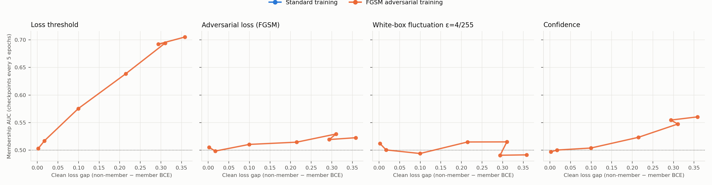

# Matched experiment v2 — results

Two victims trained with the same script, data split, seed and attack pipeline, both **without** augmentation or early stopping (last of 35 epochs): **C** standard training and **D** FGSM adversarial training (FGSM-RS by default). Members = images the victim trained on; non-members = patient-disjoint split; the 5k + 5k evaluation images are identical for C and D (paired design). Primary MIA metrics are AUC and TPR at low FPR; `acc @ 0.5` is the paper's metric (threshold learned on shadow data), `acc @ median` calls the top half of the scores members (label-free calibration on the balanced evaluation set).

## Victims

| Run | Training | Method | ε (/255) | α | Train acc | Val AUC | FGSM val AUC | PGD val AUC | Max epoch swing of FGSM val AUC | Clean test AUC |
|---|---|---|---|---|---|---|---|---|---|---|
| `fgsm_noreg_seed42` | fgsm | fgsm_rs | 4.0 | 0.5 | 0.9986 | 0.7619 | 0.4974 | 0.2324 | 0.4841 | 0.7349 |

A large epoch-to-epoch swing of the FGSM val AUC, or FGSM val AUC far above PGD val AUC, indicates catastrophic overfitting (gradient masking) of single-step AT.

## Paper-format results (the same metrics as the submitted paper)

Feature strategies as named in the paper: **Original MIA** = shadow-model MIA on confidence scores, **+ Variance** = + bootstrapped variance-of-max (BCVA), **Fluctuation** = AFMIA with the paper's features. Evasion uses the paper's ε grid (normalised units, clamp ±3, all 33,412 non-members).

### Training and generalisation (paper §IV-B3 and README key findings)

| Run | Epochs trained | Selected epoch | Train acc | Val acc | Memorization gap | Clean test AUC | Avg max-conf members | Avg max-conf non-members | Avg per-class fluctuation members (Eq. 7) | non-members |
|---|---|---|---|---|---|---|---|---|---|---|
| `fgsm_noreg_seed42` | 35 | 35 | 0.9986 | 0.9115 | +8.72 % | 0.7349 | 0.9353 | 0.8935 | 12.13 % | 9.68 % |

Eq. 7 fluctuation: FGSM ε = 0.01 (normalised) on the true labels, per-class mean |p(x) − p(x_adv)| on the 5k + 5k evaluation images, averaged over the 15 classes (paper: 2.67 % members vs 7.41 % non-members on its adversarial model).

### Table I — evasion: classification AUC and flip rate under FGSM

`fgsm_noreg_seed42` (single victim in this folder)

| ε | AUC | Flip rate |
|---|---|---|
| 0.000 (clean) | 0.7349 | — |
| 0.001 | 0.5712 | 3.8 % |
| 0.002 | 0.4730 | 5.9 % |
| 0.005 | 0.3474 | 8.4 % |
| 0.010 | 0.3022 | 9.4 % |
| 0.020 | 0.3238 | 9.4 % |

### Tables II / III — MIA results per victim (Acc / Prec / Rec / F1)

**`fgsm_noreg_seed42`** (adversarial victim)

| Feature strategy | Attack classifier | Acc | Prec | Rec | F1 |
|---|---|---|---|---|---|
| Original MIA | Gradient Boosting | 0.5667 | 0.5721 | 0.5294 | 0.5499 |
| Original MIA | Random Forest | 0.5627 | 0.5705 | 0.5074 | 0.5371 |
| Original MIA | MLP | 0.5849 | 0.5746 | 0.6536 | 0.6116 |
| Original MIA | Logistic Regression | 0.5606 | 0.5433 | 0.7610 | 0.6340 |
| Original MIA + Variance | Gradient Boosting | 0.5695 | 0.5688 | 0.5746 | 0.5717 |
| Original MIA + Variance | Random Forest | 0.5613 | 0.5669 | 0.5192 | 0.5420 |
| Original MIA + Variance | MLP | 0.5696 | 0.5632 | 0.6204 | 0.5904 |
| Original MIA + Variance | Logistic Regression | 0.5605 | 0.5427 | 0.7690 | 0.6363 |
| Fluctuation | Gradient Boosting | 0.5629 | 0.5461 | 0.7448 | 0.6302 |
| Fluctuation | Random Forest | 0.5609 | 0.5471 | 0.7078 | 0.6171 |
| Fluctuation | MLP | 0.5626 | 0.5427 | 0.7950 | 0.6451 |
| Fluctuation | Logistic Regression | 0.5454 | 0.5268 | 0.8912 | 0.6622 |
| Fluctuation + Variance | Gradient Boosting | 0.5584 | 0.5402 | 0.7842 | 0.6397 |
| Fluctuation + Variance | Random Forest | 0.5605 | 0.5462 | 0.7156 | 0.6195 |
| Fluctuation + Variance | MLP | 0.5498 | 0.5314 | 0.8434 | 0.6520 |
| Fluctuation + Variance | Logistic Regression | 0.5455 | 0.5269 | 0.8922 | 0.6625 |

## Headline — the three attacks, C vs D

_Needs both victims of a seed in this results folder — merge the two Kaggle outputs (kaggle/merge_kaggle_results.py)._

## All attack results per victim

| Run | Feature set | Classifier | AUC | TPR@1% | TPR@0.1% | Acc@0.5 | Acc@median | Best-thr acc | Prec | Rec | F1 |
|---|---|---|---|---|---|---|---|---|---|---|---|
| `fgsm_noreg_seed42` | Shadow-MIA | Gradient Boosting | 0.5944 | 0.0626 | 0.0132 | 0.5667 | 0.5666 | 0.5693 | 0.5721 | 0.5294 | 0.5499 |
| `fgsm_noreg_seed42` | Shadow-MIA | Random Forest | 0.5909 | 0.0404 | 0.0054 | 0.5627 | 0.5603 | 0.5669 | 0.5705 | 0.5074 | 0.5371 |
| `fgsm_noreg_seed42` | Shadow-MIA | MLP | 0.6271 | 0.0660 | 0.0100 | 0.5849 | 0.5882 | 0.5942 | 0.5746 | 0.6536 | 0.6116 |
| `fgsm_noreg_seed42` | Shadow-MIA | Logistic Regression | 0.6063 | 0.0436 | 0.0066 | 0.5606 | 0.5704 | 0.5724 | 0.5433 | 0.7610 | 0.6340 |
| `fgsm_noreg_seed42` | Shadow-MIA + BCVA | Gradient Boosting | 0.5998 | 0.0614 | 0.0098 | 0.5695 | 0.5698 | 0.5731 | 0.5688 | 0.5746 | 0.5717 |
| `fgsm_noreg_seed42` | Shadow-MIA + BCVA | Random Forest | 0.5918 | 0.0486 | 0.0030 | 0.5613 | 0.5611 | 0.5618 | 0.5669 | 0.5192 | 0.5420 |
| `fgsm_noreg_seed42` | Shadow-MIA + BCVA | MLP | 0.6087 | 0.0470 | 0.0120 | 0.5696 | 0.5698 | 0.5794 | 0.5632 | 0.6204 | 0.5904 |
| `fgsm_noreg_seed42` | Shadow-MIA + BCVA | Logistic Regression | 0.6057 | 0.0426 | 0.0068 | 0.5605 | 0.5688 | 0.5739 | 0.5427 | 0.7690 | 0.6363 |
| `fgsm_noreg_seed42` | AFMIA (paper features) | Gradient Boosting | 0.6054 | 0.0442 | 0.0100 | 0.5629 | 0.5680 | 0.5702 | 0.5461 | 0.7448 | 0.6302 |
| `fgsm_noreg_seed42` | AFMIA (paper features) | Random Forest | 0.5977 | 0.0386 | 0.0056 | 0.5609 | 0.5664 | 0.5680 | 0.5471 | 0.7078 | 0.6171 |
| `fgsm_noreg_seed42` | AFMIA (paper features) | MLP | 0.6065 | 0.0428 | 0.0038 | 0.5626 | 0.5726 | 0.5802 | 0.5427 | 0.7950 | 0.6451 |
| `fgsm_noreg_seed42` | AFMIA (paper features) | Logistic Regression | 0.5769 | 0.0146 | 0.0016 | 0.5454 | 0.5594 | 0.5714 | 0.5268 | 0.8912 | 0.6622 |
| `fgsm_noreg_seed42` | AFMIA (paper features) + BCVA | Gradient Boosting | 0.6059 | 0.0456 | 0.0084 | 0.5584 | 0.5688 | 0.5723 | 0.5402 | 0.7842 | 0.6397 |
| `fgsm_noreg_seed42` | AFMIA (paper features) + BCVA | Random Forest | 0.5967 | 0.0336 | 0.0026 | 0.5605 | 0.5653 | 0.5659 | 0.5462 | 0.7156 | 0.6195 |
| `fgsm_noreg_seed42` | AFMIA (paper features) + BCVA | MLP | 0.5971 | 0.0360 | 0.0074 | 0.5498 | 0.5564 | 0.5675 | 0.5314 | 0.8434 | 0.6520 |
| `fgsm_noreg_seed42` | AFMIA (paper features) + BCVA | Logistic Regression | 0.5757 | 0.0158 | 0.0032 | 0.5455 | 0.5542 | 0.5686 | 0.5269 | 0.8922 | 0.6625 |
| `fgsm_noreg_seed42` | AFMIA-v2 (perturbation only) | Gradient Boosting | 0.5022 | 0.0138 | 0.0024 | 0.5013 | 0.4902 | 0.5099 | 0.5007 | 0.9556 | 0.6571 |
| `fgsm_noreg_seed42` | AFMIA-v2 (perturbation only) | Random Forest | 0.5049 | 0.0114 | 0.0014 | 0.4975 | 0.4972 | 0.5071 | 0.4987 | 0.9532 | 0.6548 |
| `fgsm_noreg_seed42` | AFMIA-v2 (perturbation only) | MLP | 0.5618 | 0.0160 | 0.0022 | 0.5111 | 0.5438 | 0.5503 | 0.5059 | 0.9590 | 0.6623 |
| `fgsm_noreg_seed42` | AFMIA-v2 (perturbation only) | Logistic Regression | 0.5737 | 0.0096 | 0.0010 | 0.5176 | 0.5614 | 0.5627 | 0.5097 | 0.9260 | 0.6575 |
| `fgsm_noreg_seed42` | AFMIA-v2 (+ clean confidence) | Gradient Boosting | 0.6177 | 0.0506 | 0.0076 | 0.5746 | 0.5824 | 0.5838 | 0.5570 | 0.7286 | 0.6314 |
| `fgsm_noreg_seed42` | AFMIA-v2 (+ clean confidence) | Random Forest | 0.5840 | 0.0288 | 0.0028 | 0.5282 | 0.5570 | 0.5606 | 0.5164 | 0.8884 | 0.6531 |
| `fgsm_noreg_seed42` | AFMIA-v2 (+ clean confidence) | MLP | 0.5834 | 0.0182 | 0.0036 | 0.5546 | 0.5548 | 0.5676 | 0.5334 | 0.8718 | 0.6619 |
| `fgsm_noreg_seed42` | AFMIA-v2 (+ clean confidence) | Logistic Regression | 0.5890 | 0.0148 | 0.0008 | 0.5489 | 0.5692 | 0.5737 | 0.5296 | 0.8740 | 0.6596 |
| `fgsm_noreg_seed42` | Shadow-MIA (AT shadows) | Gradient Boosting | 0.6072 | 0.0474 | 0.0088 | 0.5686 | 0.5692 | 0.5746 | 0.5584 | 0.6558 | 0.6032 |
| `fgsm_noreg_seed42` | Shadow-MIA (AT shadows) | Random Forest | 0.6059 | 0.0296 | 0.0048 | 0.5710 | 0.5714 | 0.5714 | 0.5655 | 0.6128 | 0.5882 |
| `fgsm_noreg_seed42` | Shadow-MIA (AT shadows) | MLP | 0.6184 | 0.0352 | 0.0098 | 0.5701 | 0.5808 | 0.5880 | 0.5523 | 0.7408 | 0.6328 |
| `fgsm_noreg_seed42` | Shadow-MIA (AT shadows) | Logistic Regression | 0.6074 | 0.0382 | 0.0022 | 0.5588 | 0.5706 | 0.5770 | 0.5390 | 0.8122 | 0.6480 |

`Best-thr acc` picks the threshold on the evaluation labels — optimistic.

## Classifier-free scores on the victim (from the attack runs)

| Run | Attack run | Score | AUC on victim | TPR@1% | Acc@median | AUC on attacker's shadow rows |
|---|---|---|---|---|---|---|
| `fgsm_noreg_seed42` | shadow_mia_std | certainty | 0.5605 | 0.0156 | 0.5456 | 0.6352 |
| `fgsm_noreg_seed42` | shadow_mia_std | max_conf | 0.6053 | 0.0176 | 0.5786 | 0.6602 |
| `fgsm_noreg_seed42` | afmia | certainty | 0.5605 | 0.0156 | 0.5456 | 0.5975 |
| `fgsm_noreg_seed42` | afmia | max_conf | 0.6053 | 0.0176 | 0.5786 | 0.6297 |
| `fgsm_noreg_seed42` | afmia | neg_clean_loss_own | 0.5596 | 0.0156 | 0.5458 | 0.5970 |
| `fgsm_noreg_seed42` | afmia | neg_fl_sum_e1 | 0.5734 | 0.0162 | 0.5590 | 0.5772 |
| `fgsm_noreg_seed42` | afmia | neg_dz_mean_e1 | 0.5293 | 0.0162 | 0.5210 | 0.5099 |
| `fgsm_noreg_seed42` | afmia | neg_adv_loss_own_e1 | 0.5832 | 0.0146 | 0.5718 | 0.5966 |
| `fgsm_noreg_seed42` | afmia | neg_fl_sum_e2 | 0.5840 | 0.0186 | 0.5630 | 0.5780 |
| `fgsm_noreg_seed42` | afmia | neg_dz_mean_e2 | 0.5363 | 0.0186 | 0.5276 | 0.5088 |
| `fgsm_noreg_seed42` | afmia | neg_adv_loss_own_e2 | 0.5859 | 0.0190 | 0.5766 | 0.5927 |
| `fgsm_noreg_seed42` | afmia | neg_fl_sum_e4 | 0.5357 | 0.0174 | 0.5268 | 0.5584 |
| `fgsm_noreg_seed42` | afmia | neg_dz_mean_e4 | 0.5122 | 0.0142 | 0.5052 | 0.5028 |
| `fgsm_noreg_seed42` | afmia | neg_adv_loss_own_e4 | 0.5393 | 0.0124 | 0.5256 | 0.5674 |
| `fgsm_noreg_seed42` | afmia | neg_fl_sum_e8 | 0.4717 | 0.0218 | 0.4748 | 0.5335 |
| `fgsm_noreg_seed42` | afmia | neg_dz_mean_e8 | 0.4922 | 0.0136 | 0.4970 | 0.4947 |
| `fgsm_noreg_seed42` | afmia | neg_adv_loss_own_e8 | 0.4804 | 0.0220 | 0.4854 | 0.5391 |
| `fgsm_noreg_seed42` | shadow_mia_at | certainty | 0.5605 | 0.0156 | 0.5456 | 0.5975 |
| `fgsm_noreg_seed42` | shadow_mia_at | max_conf | 0.6053 | 0.0176 | 0.5786 | 0.6297 |

A score with AUC > 0.5 on the shadow rows but < 0.5 on a victim is a signal the attacker learned that points the other way on that victim.

## Evasion detail

**`fgsm_noreg_seed42`** — clean AUC 0.7349

| Attack | ε (/255) | Adv. AUC | Flip rate |
|---|---|---|---|
| FGSM | 0.5 | 0.3079 | 0.0927 |
| FGSM | 1 | 0.3131 | 0.0950 |
| FGSM | 2 | 0.3636 | 0.0897 |
| FGSM | 4 | 0.4935 | 0.1942 |
| FGSM | 8 | 0.5117 | 0.3136 |
| PGD | 1 | 0.3283 | 0.1334 |
| PGD | 2 | 0.3415 | 0.1483 |
| PGD | 4 | 0.3096 | 0.1616 |

## Gap-matched analysis (checkpoints every 5 epochs)

## Missing outputs

- none
