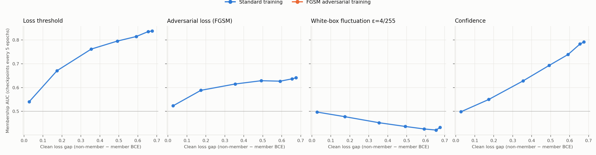

# Matched experiment v2 — results

Two victims trained with the same script, data split, seed and attack pipeline, both **without** augmentation or early stopping (last of 35 epochs): **C** standard training and **D** FGSM adversarial training (FGSM-RS by default). Members = images the victim trained on; non-members = patient-disjoint split; the 5k + 5k evaluation images are identical for C and D (paired design). Primary MIA metrics are AUC and TPR at low FPR; `acc @ 0.5` is the paper's metric (threshold learned on shadow data), `acc @ median` calls the top half of the scores members (label-free calibration on the balanced evaluation set).

## Victims

| Run | Training | Method | ε (/255) | α | Train acc | Val AUC | FGSM val AUC | PGD val AUC | Max epoch swing of FGSM val AUC | Clean test AUC |
|---|---|---|---|---|---|---|---|---|---|---|
| `std_noreg_seed42` | standard | — | — | — | 0.9999 | 0.7732 | 0.1984 | 0.0724 | 0.1402 | 0.7625 |

A large epoch-to-epoch swing of the FGSM val AUC, or FGSM val AUC far above PGD val AUC, indicates catastrophic overfitting (gradient masking) of single-step AT.

## Paper-format results (the same metrics as the submitted paper)

Feature strategies as named in the paper: **Original MIA** = shadow-model MIA on confidence scores, **+ Variance** = + bootstrapped variance-of-max (BCVA), **Fluctuation** = AFMIA with the paper's features. Evasion uses the paper's ε grid (normalised units, clamp ±3, all 33,412 non-members).

### Training and generalisation (paper §IV-B3 and README key findings)

| Run | Epochs trained | Selected epoch | Train acc | Val acc | Memorization gap | Clean test AUC | Avg max-conf members | Avg max-conf non-members | Avg per-class fluctuation members (Eq. 7) | non-members |
|---|---|---|---|---|---|---|---|---|---|---|
| `std_noreg_seed42` | 35 | 35 | 0.9999 | 0.9190 | +8.09 % | 0.7625 | 0.9999 | 0.8818 | 22.66 % | 14.97 % |

Eq. 7 fluctuation: FGSM ε = 0.01 (normalised) on the true labels, per-class mean |p(x) − p(x_adv)| on the 5k + 5k evaluation images, averaged over the 15 classes (paper: 2.67 % members vs 7.41 % non-members on its adversarial model).

### Table I — evasion: classification AUC and flip rate under FGSM

`std_noreg_seed42` (single victim in this folder)

| ε | AUC | Flip rate |
|---|---|---|
| 0.000 (clean) | 0.7625 | — |
| 0.001 | 0.2764 | 9.7 % |
| 0.002 | 0.2272 | 11.8 % |
| 0.005 | 0.1928 | 14.1 % |
| 0.010 | 0.1787 | 15.2 % |
| 0.020 | 0.1732 | 15.2 % |

### Tables II / III — MIA results per victim (Acc / Prec / Rec / F1)

**`std_noreg_seed42`** (baseline victim)

| Feature strategy | Attack classifier | Acc | Prec | Rec | F1 |
|---|---|---|---|---|---|
| Original MIA | Gradient Boosting | 0.6831 | 0.6154 | 0.9764 | 0.7550 |
| Original MIA | Random Forest | 0.6783 | 0.6191 | 0.9270 | 0.7424 |
| Original MIA | MLP | 0.6540 | 0.5915 | 0.9952 | 0.7420 |
| Original MIA | Logistic Regression | 0.5940 | 0.5550 | 0.9492 | 0.7004 |
| Original MIA + Variance | Gradient Boosting | 0.6799 | 0.6134 | 0.9728 | 0.7524 |
| Original MIA + Variance | Random Forest | 0.6782 | 0.6179 | 0.9342 | 0.7438 |
| Original MIA + Variance | MLP | 0.6655 | 0.5996 | 0.9960 | 0.7486 |
| Original MIA + Variance | Logistic Regression | 0.5926 | 0.5542 | 0.9474 | 0.6993 |
| Fluctuation | Gradient Boosting | 0.6456 | 0.5852 | 1.0000 | 0.7383 |
| Fluctuation | Random Forest | 0.6489 | 0.5888 | 0.9874 | 0.7377 |
| Fluctuation | MLP | 0.6117 | 0.5629 | 1.0000 | 0.7203 |
| Fluctuation | Logistic Regression | 0.5874 | 0.5479 | 1.0000 | 0.7079 |
| Fluctuation + Variance | Gradient Boosting | 0.6315 | 0.5757 | 1.0000 | 0.7307 |
| Fluctuation + Variance | Random Forest | 0.6399 | 0.5840 | 0.9722 | 0.7297 |
| Fluctuation + Variance | MLP | 0.6204 | 0.5685 | 0.9998 | 0.7248 |
| Fluctuation + Variance | Logistic Regression | 0.5931 | 0.5513 | 1.0000 | 0.7108 |

## Headline — the three attacks, C vs D

_Needs both victims of a seed in this results folder — merge the two Kaggle outputs (kaggle/merge_kaggle_results.py)._

## All attack results per victim

| Run | Feature set | Classifier | AUC | TPR@1% | TPR@0.1% | Acc@0.5 | Acc@median | Best-thr acc | Prec | Rec | F1 |
|---|---|---|---|---|---|---|---|---|---|---|---|
| `std_noreg_seed42` | Shadow-MIA | Gradient Boosting | 0.8050 | 0.1830 | 0.0418 | 0.6831 | 0.7060 | 0.7098 | 0.6154 | 0.9764 | 0.7550 |
| `std_noreg_seed42` | Shadow-MIA | Random Forest | 0.7980 | 0.1284 | 0.0084 | 0.6783 | 0.7072 | 0.7107 | 0.6191 | 0.9270 | 0.7424 |
| `std_noreg_seed42` | Shadow-MIA | MLP | 0.7923 | 0.0668 | 0.0092 | 0.6540 | 0.6924 | 0.7496 | 0.5915 | 0.9952 | 0.7420 |
| `std_noreg_seed42` | Shadow-MIA | Logistic Regression | 0.7004 | 0.0470 | 0.0104 | 0.5940 | 0.6488 | 0.6808 | 0.5550 | 0.9492 | 0.7004 |
| `std_noreg_seed42` | Shadow-MIA + BCVA | Gradient Boosting | 0.8041 | 0.2054 | 0.0724 | 0.6799 | 0.7042 | 0.7092 | 0.6134 | 0.9728 | 0.7524 |
| `std_noreg_seed42` | Shadow-MIA + BCVA | Random Forest | 0.7970 | 0.1416 | 0.0238 | 0.6782 | 0.7073 | 0.7091 | 0.6179 | 0.9342 | 0.7438 |
| `std_noreg_seed42` | Shadow-MIA + BCVA | MLP | 0.7802 | 0.0542 | 0.0072 | 0.6655 | 0.6904 | 0.7283 | 0.5996 | 0.9960 | 0.7486 |
| `std_noreg_seed42` | Shadow-MIA + BCVA | Logistic Regression | 0.6735 | 0.0414 | 0.0068 | 0.5926 | 0.6100 | 0.6325 | 0.5542 | 0.9474 | 0.6993 |
| `std_noreg_seed42` | AFMIA (paper features) | Gradient Boosting | 0.7794 | 0.1868 | 0.0414 | 0.6456 | 0.6660 | 0.6953 | 0.5852 | 1.0000 | 0.7383 |
| `std_noreg_seed42` | AFMIA (paper features) | Random Forest | 0.8005 | 0.1074 | 0.0272 | 0.6489 | 0.7025 | 0.7072 | 0.5888 | 0.9874 | 0.7377 |
| `std_noreg_seed42` | AFMIA (paper features) | MLP | 0.7596 | 0.0892 | 0.0006 | 0.6117 | 0.6402 | 0.7070 | 0.5629 | 1.0000 | 0.7203 |
| `std_noreg_seed42` | AFMIA (paper features) | Logistic Regression | 0.8557 | 0.1728 | 0.0154 | 0.5874 | 0.7544 | 0.7934 | 0.5479 | 1.0000 | 0.7079 |
| `std_noreg_seed42` | AFMIA (paper features) + BCVA | Gradient Boosting | 0.7623 | 0.1892 | 0.0406 | 0.6315 | 0.6492 | 0.6811 | 0.5757 | 1.0000 | 0.7307 |
| `std_noreg_seed42` | AFMIA (paper features) + BCVA | Random Forest | 0.7916 | 0.1034 | 0.0188 | 0.6399 | 0.7015 | 0.7018 | 0.5840 | 0.9722 | 0.7297 |
| `std_noreg_seed42` | AFMIA (paper features) + BCVA | MLP | 0.7072 | 0.0476 | 0.0026 | 0.6204 | 0.6052 | 0.6566 | 0.5685 | 0.9998 | 0.7248 |
| `std_noreg_seed42` | AFMIA (paper features) + BCVA | Logistic Regression | 0.7076 | 0.0334 | 0.0060 | 0.5931 | 0.6366 | 0.6625 | 0.5513 | 1.0000 | 0.7108 |
| `std_noreg_seed42` | AFMIA-v2 (perturbation only) | Gradient Boosting | 0.7362 | 0.0456 | 0.0070 | 0.6430 | 0.6678 | 0.6748 | 0.5889 | 0.9470 | 0.7262 |
| `std_noreg_seed42` | AFMIA-v2 (perturbation only) | Random Forest | 0.6655 | 0.0230 | 0.0026 | 0.6089 | 0.6108 | 0.6217 | 0.5727 | 0.8580 | 0.6869 |
| `std_noreg_seed42` | AFMIA-v2 (perturbation only) | MLP | 0.7116 | 0.0462 | 0.0048 | 0.6243 | 0.6452 | 0.6554 | 0.5765 | 0.9364 | 0.7137 |
| `std_noreg_seed42` | AFMIA-v2 (perturbation only) | Logistic Regression | 0.7225 | 0.0456 | 0.0070 | 0.6061 | 0.6634 | 0.6679 | 0.5630 | 0.9488 | 0.7066 |
| `std_noreg_seed42` | AFMIA-v2 (+ clean confidence) | Gradient Boosting | 0.7881 | 0.1858 | 0.0418 | 0.6656 | 0.6810 | 0.6949 | 0.6024 | 0.9738 | 0.7444 |
| `std_noreg_seed42` | AFMIA-v2 (+ clean confidence) | Random Forest | 0.7410 | 0.0488 | 0.0050 | 0.6395 | 0.6627 | 0.6650 | 0.5920 | 0.8980 | 0.7135 |
| `std_noreg_seed42` | AFMIA-v2 (+ clean confidence) | MLP | 0.7234 | 0.0906 | 0.0166 | 0.6227 | 0.6482 | 0.6520 | 0.5764 | 0.9256 | 0.7104 |
| `std_noreg_seed42` | AFMIA-v2 (+ clean confidence) | Logistic Regression | 0.7203 | 0.0350 | 0.0024 | 0.6294 | 0.6482 | 0.6589 | 0.5757 | 0.9838 | 0.7264 |
| `std_noreg_seed42` | Shadow-MIA (AT shadows) | Gradient Boosting | 0.7893 | 0.2010 | 0.0378 | 0.6829 | 0.6804 | 0.7024 | 0.6150 | 0.9778 | 0.7551 |
| `std_noreg_seed42` | Shadow-MIA (AT shadows) | Random Forest | 0.7625 | 0.1180 | 0.0384 | 0.6561 | 0.6750 | 0.6751 | 0.6081 | 0.8780 | 0.7186 |
| `std_noreg_seed42` | Shadow-MIA (AT shadows) | MLP | 0.7562 | 0.0878 | 0.0246 | 0.6348 | 0.6468 | 0.7174 | 0.5782 | 0.9964 | 0.7318 |
| `std_noreg_seed42` | Shadow-MIA (AT shadows) | Logistic Regression | 0.7052 | 0.0304 | 0.0128 | 0.6030 | 0.6398 | 0.6865 | 0.5591 | 0.9742 | 0.7105 |

`Best-thr acc` picks the threshold on the evaluation labels — optimistic.

## Classifier-free scores on the victim (from the attack runs)

| Run | Attack run | Score | AUC on victim | TPR@1% | Acc@median | AUC on attacker's shadow rows |
|---|---|---|---|---|---|---|
| `std_noreg_seed42` | shadow_mia_std | certainty | 0.7913 | 0.0000 | 0.7230 | 0.6321 |
| `std_noreg_seed42` | shadow_mia_std | max_conf | 0.8338 | 0.0000 | 0.7551 | 0.6637 |
| `std_noreg_seed42` | afmia | certainty | 0.7911 | 0.0124 | 0.7230 | 0.5905 |
| `std_noreg_seed42` | afmia | max_conf | 0.8338 | 0.0000 | 0.7551 | 0.6361 |
| `std_noreg_seed42` | afmia | neg_clean_loss_own | 0.7911 | 0.0000 | 0.7230 | 0.5902 |
| `std_noreg_seed42` | afmia | neg_fl_sum_e1 | 0.7597 | 0.0088 | 0.7096 | 0.5720 |
| `std_noreg_seed42` | afmia | neg_dz_mean_e1 | 0.5797 | 0.0000 | 0.5598 | 0.5084 |
| `std_noreg_seed42` | afmia | neg_adv_loss_own_e1 | 0.7501 | 0.0002 | 0.6976 | 0.5882 |
| `std_noreg_seed42` | afmia | neg_fl_sum_e2 | 0.6739 | 0.0126 | 0.6524 | 0.5683 |
| `std_noreg_seed42` | afmia | neg_dz_mean_e2 | 0.5196 | 0.0122 | 0.5128 | 0.5063 |
| `std_noreg_seed42` | afmia | neg_adv_loss_own_e2 | 0.6636 | 0.0062 | 0.6332 | 0.5808 |
| `std_noreg_seed42` | afmia | neg_fl_sum_e4 | 0.5414 | 0.0156 | 0.5202 | 0.5558 |
| `std_noreg_seed42` | afmia | neg_dz_mean_e4 | 0.4513 | 0.0136 | 0.4588 | 0.4999 |
| `std_noreg_seed42` | afmia | neg_adv_loss_own_e4 | 0.5435 | 0.0142 | 0.5316 | 0.5617 |
| `std_noreg_seed42` | afmia | neg_fl_sum_e8 | 0.4659 | 0.0122 | 0.4782 | 0.5303 |
| `std_noreg_seed42` | afmia | neg_dz_mean_e8 | 0.4200 | 0.0106 | 0.4384 | 0.4899 |
| `std_noreg_seed42` | afmia | neg_adv_loss_own_e8 | 0.4660 | 0.0074 | 0.4720 | 0.5310 |
| `std_noreg_seed42` | shadow_mia_at | certainty | 0.7913 | 0.0000 | 0.7230 | 0.5905 |
| `std_noreg_seed42` | shadow_mia_at | max_conf | 0.8338 | 0.0000 | 0.7551 | 0.6361 |

A score with AUC > 0.5 on the shadow rows but < 0.5 on a victim is a signal the attacker learned that points the other way on that victim.

## Evasion detail

**`std_noreg_seed42`** — clean AUC 0.7625

| Attack | ε (/255) | Adv. AUC | Flip rate |
|---|---|---|---|
| FGSM | 0.5 | 0.1810 | 0.1505 |
| FGSM | 1 | 0.1736 | 0.1534 |
| FGSM | 2 | 0.1795 | 0.1419 |
| FGSM | 4 | 0.2304 | 0.1174 |
| FGSM | 8 | 0.3977 | 0.0868 |
| PGD | 1 | 0.1840 | 0.2420 |
| PGD | 2 | 0.1763 | 0.2744 |
| PGD | 4 | 0.1662 | 0.2921 |

## Gap-matched analysis (checkpoints every 5 epochs)

## Missing outputs

- none
