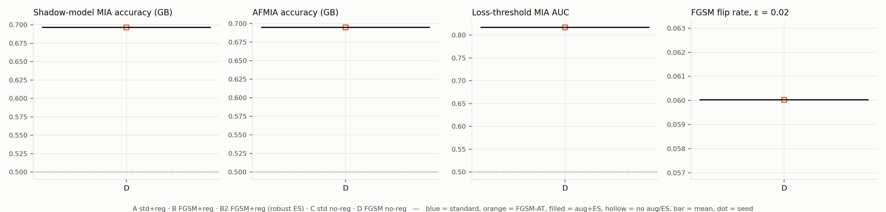

## Per-cell results (mean ± std over seeds)

| Metric | D |
|---|---|
| Shadow-MIA acc (GB) | 0.6965 (n=1) |
| Shadow-MIA AUC (GB) | 0.8314 (n=1) |
| Shadow-MIA+BCVA acc (GB) | 0.6881 (n=1) |
| AFMIA acc (GB) | 0.6946 (n=1) |
| AFMIA AUC (GB) | 0.7982 (n=1) |
| AFMIA TPR@1%FPR (GB) | 0.1994 (n=1) |
| AFMIA+BCVA acc (GB) | 0.6850 (n=1) |
| Loss-threshold AUC | 0.8170 (n=1) |
| White-box fluctuation AUC | 0.6811 (n=1) |
| Adv-loss-threshold AUC | 0.8129 (n=1) |
| Clean loss gap (NM − M) | 0.6104 (n=1) |
| Train−val acc gap | 0.0798 (n=1) |
| Clean test AUC | 0.7526 (n=1) |
| FGSM flip rate ε=0.02 | 0.0600 (n=1) |
| FGSM test AUC ε=0.02 | 0.5387 (n=1) |

## Gap-matched analysis

_Not enough checkpoints yet._

## Reference: numbers reported in the submitted paper (1 seed)

| Metric | Baseline (≈A) | Adversarial (≈D) |
|---|---|---|
| Shadow-MIA acc (GB) | 0.5000 | 0.6831 |
| Shadow-MIA+BCVA acc (GB) | 0.5000 | 0.6831 |
| AFMIA acc (GB) | 0.5016 | 0.6730 |
| AFMIA+BCVA acc (GB) | 0.5004 | 0.6744 |
| Clean test AUC | 0.8278 | 0.7516 |
| FGSM flip rate ε=0.02 | 0.261 | 0.039 |

The original runs used one seed, trained the baseline with 30 max epochs / eta_min 0, augmented full-size PNGs, and drew their 5k eval members from a different (but also clean) sample of training images; differences to the new D − A contrast should be read with that in mind.

## Missing outputs

- none
