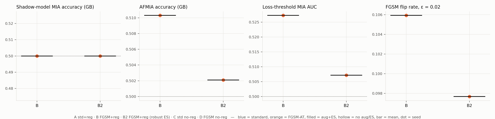

# Matched-control experiment — results

Design: 2 × 2 (training loss × regularisation) with the same script, data split, seed set and attack pipeline for every cell; B2 = cell B selected by adversarial val AUC. Members = images the victim trained on (validation hold-out excluded); non-members = patient-disjoint split. Attack seed = victim seed (paired design).

Runs found: 2 victims, seeds [42].

| Cell | Description |
|---|---|
| A `std_reg` | Standard loss, augmentation + early stopping (clean val AUC) |
| B `fgsm_reg` | FGSM-AT, augmentation + early stopping (clean val AUC) |
| B2 `fgsm_reg_robustES` | FGSM-AT, augmentation + early stopping (adversarial val AUC) |
| C `std_noreg` | Standard loss, no augmentation, no early stopping (35 ep) |
| D `fgsm_noreg` | FGSM-AT, no augmentation, no early stopping (35 ep) |

## Per-cell results (mean ± std over seeds)

| Metric | B | B2 |
|---|---|---|
| Shadow-MIA acc (GB) | 0.5000 (n=1) | 0.5000 (n=1) |
| Shadow-MIA AUC (GB) | 0.5093 (n=1) | 0.4965 (n=1) |
| Shadow-MIA+BCVA acc (GB) | 0.5000 (n=1) | 0.5000 (n=1) |
| AFMIA acc (GB) | 0.5103 (n=1) | 0.5021 (n=1) |
| AFMIA AUC (GB) | 0.5139 (n=1) | 0.5066 (n=1) |
| AFMIA TPR@1%FPR (GB) | 0.0152 (n=1) | 0.0086 (n=1) |
| AFMIA+BCVA acc (GB) | 0.5065 (n=1) | 0.5015 (n=1) |
| Loss-threshold AUC | 0.5273 (n=1) | 0.5072 (n=1) |
| White-box fluctuation AUC | 0.5018 (n=1) | 0.5066 (n=1) |
| Adv-loss-threshold AUC | 0.5196 (n=1) | 0.5085 (n=1) |
| Clean loss gap (NM − M) | 0.0195 (n=1) | 0.0055 (n=1) |
| Train−val acc gap | 0.0128 (n=1) | 0.0179 (n=1) |
| Clean test AUC | 0.8174 (n=1) | 0.8159 (n=1) |
| FGSM flip rate ε=0.02 | 0.1059 (n=1) | 0.0977 (n=1) |
| FGSM test AUC ε=0.02 | 0.6596 (n=1) | 0.8150 (n=1) |

## Paired contrasts (difference of cells within each seed; 95 % t-CI)

`*` = CI excludes 0. With 3 seeds the CI is wide; report it, don't over-read it.

### Robust-ES vs clean-ES | AT (B2 − B)

| Metric | mean Δ | 95 % CI | n | per-seed Δ |
|---|---|---|---|---|
| Shadow-MIA acc (GB) | +0.0000 | — | 1 | +0.0000 |
| Shadow-MIA AUC (GB) | -0.0129 | — | 1 | -0.0129 |
| Shadow-MIA+BCVA acc (GB) | +0.0000 | — | 1 | +0.0000 |
| AFMIA acc (GB) | -0.0082 | — | 1 | -0.0082 |
| AFMIA AUC (GB) | -0.0073 | — | 1 | -0.0073 |
| AFMIA TPR@1%FPR (GB) | -0.0066 | — | 1 | -0.0066 |
| AFMIA+BCVA acc (GB) | -0.0050 | — | 1 | -0.0050 |
| Loss-threshold AUC | -0.0201 | — | 1 | -0.0201 |
| White-box fluctuation AUC | +0.0049 | — | 1 | +0.0049 |
| Adv-loss-threshold AUC | -0.0111 | — | 1 | -0.0111 |
| Clean loss gap (NM − M) | -0.0140 | — | 1 | -0.0140 |
| Train−val acc gap | +0.0051 | — | 1 | +0.0051 |
| Clean test AUC | -0.0015 | — | 1 | -0.0015 |
| FGSM flip rate ε=0.02 | -0.0082 | — | 1 | -0.0082 |
| FGSM test AUC ε=0.02 | +0.1553 | — | 1 | +0.1553 |

## Gap-matched analysis

_Not enough checkpoints yet._

## Reference: numbers reported in the submitted paper (1 seed)

| Metric | Baseline (≈A) | Adversarial (≈D) |
|---|---|---|
| Shadow-MIA acc (GB) | 0.5000 | 0.6831 |
| Shadow-MIA+BCVA acc (GB) | 0.5000 | 0.6831 |
| AFMIA acc (GB) | 0.5016 | 0.6730 |
| AFMIA+BCVA acc (GB) | 0.5004 | 0.6744 |
| Clean test AUC | 0.8278 | 0.7516 |
| FGSM flip rate ε=0.02 | 0.261 | 0.039 |

The original runs used one seed, trained the baseline with 30 max epochs / eta_min 0, augmented full-size PNGs, and drew their 5k eval members from a different (but also clean) sample of training images; differences to the new D − A contrast should be read with that in mind.

## Missing outputs

- none
